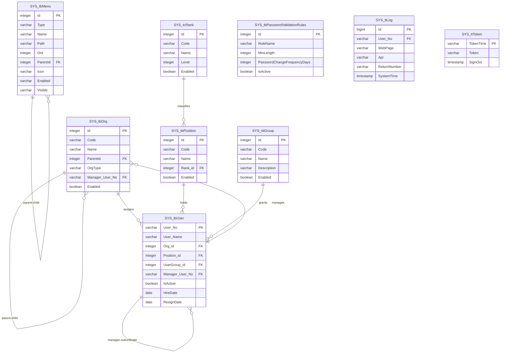

# 資料庫 Schema 說明

> ⚠️ **資料庫引擎：PostgreSQL**：本專案資料庫引擎已由 SQL Server 改為 **PostgreSQL**，下列型別以 PostgreSQL 型別描述。後端查詢執行層已改用 `Application/Common/Infrastructure/Data/clsPostgreDB.cs`（`Npgsql`），程式碼中既有 SQL 已改寫為 PostgreSQL 語法，詳見 `docs/server/README.md` 的「資料庫引擎（PostgreSQL）」章節與 `docs/server/clsPostgreDB.md`。⚠️ 尚未在真正的 PostgreSQL 伺服器上驗證過（本機開發環境無可用的 PostgreSQL 執行個體），僅完成程式碼層級的語法轉換與編譯驗證；已停用的 SQL Server 實作（`clsDapper.cs`）仍保留在專案中供參考，詳見 `docs/server/clsDapper.md`。

## 系統資料表

### SYS_tbMenu (選單資料表)
| 欄位名稱 | 資料型別 | 長度 | 允許空值 | 預設值 | 說明 |
|---------|---------|------|---------|-------|------|
| Id | integer | - | NO | - | 流水號 (PK) |
| Type | varchar | 10 | NO | 'app' | 型態 |
| Name | varchar | 20 | YES | - | 節點名稱 |
| Path | varchar | 50 | YES | - | 節點路徑 |
| Ord | integer | - | NO | 0 | 排序 |
| ParentId | integer | - | NO | 0 | 父節點id (FK: SYS_tbMenu.Id) |
| Icon | varchar | 50 | YES | - | Icon路徑 |
| NewWindow | varchar | 1 | NO | 'N' | 是否開新分頁 |
| Enabled | varchar | 1 | NO | 'Y' | 是否啟用 |
| Visible | varchar | 1 | NO | 'Y' | 是否顯示 |
| Global | varchar | 1 | NO | 'N' | 是否為全域 |
| Auth | varchar | 1 | NO | 'Y' | 是否驗證登入的狀態 |
| CreateDate | timestamp | - | NO | now() | 新增時間 |

### SYS_tbPasswordValidationRules (密碼驗證規則表)
| 欄位名稱 | 資料型別 | 長度 | 允許空值 | 預設值 | 說明 |
|---------|---------|------|---------|-------|------|
| Id | integer | - | NO | - | 流水號 (PK) |
| RuleName | varchar | 100 | NO | - | 名稱 |
| MinLength | integer | - | NO | 8 | 密碼最小長度 |
| PasswordChangeFrequencyDays | integer | - | NO | 90 | 密碼更新頻率 |
| MinUppercaseLength | integer | - | NO | 1 | 大寫英文最小長度 |
| MinLowercaseLength | integer | - | NO | 1 | 小寫英文最小長度 |
| MinSpecialCharLength | integer | - | NO | 1 | 特殊符號最小長度 |
| MinNumericLength | integer | - | NO | 1 | 數字最小長度 |
| TokenLimit | integer | - | NO | 480 | Token期限(分鐘) |
| MaxFailedLogin | integer | - | NO | 3 | 登入失敗次數上限 |
| AccountLockoutTime | integer | - | NO | 30 | 帳號鎖定時間(分鐘) |
| IsActive | boolean | - | NO | true | 是否啟用 |
| update_dt | timestamp | - | YES | - | 更新時間 |
| update_user | varchar | 20 | YES | - | 更新人員 |
| insert_dt | timestamp | - | YES | now() | 新增時間 |
| insert_user | varchar | 20 | YES | - | 新增人員 |

## 人事組織資料表

### SYS_tbOrg (組織資料表)
| 欄位名稱 | 資料型別 | 長度 | 允許空值 | 預設值 | 說明 |
|---------|---------|------|---------|-------|------|
| Id | integer | - | NO | - | 流水號 (PK) |
| Code | varchar | 20 | YES | - | 組織代碼（可對應人事系統組織代碼） |
| Name | varchar | 50 | NO | - | 組織名稱 |
| ParentId | integer | - | NO | 0 | 父組織id (邏輯上參照 SYS_tbOrg.Id；0 代表頂層組織，比照 SYS_tbMenu.ParentId 慣例，不建立強制 FK) |
| OrgType | varchar | 10 | YES | - | 組織類型（如：處/部/課/組） |
| Ord | integer | - | NO | 0 | 排序 |
| Manager_User_No | varchar | 20 | YES | - | 主管帳號 (FK: SYS_tbUser.User_No) |
| Enabled | boolean | - | NO | true | 是否啟用 |
| update_dt | timestamp | - | YES | - | 更新時間 |
| update_user | varchar | 20 | YES | - | 更新人員 |
| insert_dt | timestamp | - | NO | now() | 新增時間 |
| insert_user | varchar | 20 | YES | - | 新增人員 |

### SYS_tcRank (職等代碼表)
| 欄位名稱 | 資料型別 | 長度 | 允許空值 | 預設值 | 說明 |
|---------|---------|------|---------|-------|------|
| Id | integer | - | NO | - | 流水號 (PK) |
| Code | varchar | 20 | YES | - | 職等代碼（如：薦8） |
| Name | varchar | 50 | NO | - | 職等名稱（如：薦任八職等） |
| Level | integer | - | NO | 0 | 職等層級數值，數字越大代表職等越高，供簽核層級比較、排序使用 |
| Enabled | boolean | - | NO | true | 是否啟用 |
| update_dt | timestamp | - | YES | - | 更新時間 |
| update_user | varchar | 20 | YES | - | 更新人員 |
| insert_dt | timestamp | - | NO | now() | 新增時間 |
| insert_user | varchar | 20 | YES | - | 新增人員 |

> `SYS_tcRank` 是「命名規則」中 `SYS_tc`（系統代碼表）前綴的第一個實例。

### SYS_tbPosition (職稱資料表)
| 欄位名稱 | 資料型別 | 長度 | 允許空值 | 預設值 | 說明 |
|---------|---------|------|---------|-------|------|
| Id | integer | - | NO | - | 流水號 (PK) |
| Code | varchar | 20 | YES | - | 職稱代碼 |
| Name | varchar | 50 | NO | - | 職稱名稱 |
| Rank_id | integer | - | YES | - | 所屬職等id (FK: SYS_tcRank.Id)。一個職等可對應多個職稱；職稱本身不直接帶數值層級 |
| Ord | integer | - | NO | 0 | 排序 |
| Enabled | boolean | - | NO | true | 是否啟用 |
| update_dt | timestamp | - | YES | - | 更新時間 |
| update_user | varchar | 20 | YES | - | 更新人員 |
| insert_dt | timestamp | - | NO | now() | 新增時間 |
| insert_user | varchar | 20 | YES | - | 新增人員 |

### SYS_tbGroup (權限群組資料表)
| 欄位名稱 | 資料型別 | 長度 | 允許空值 | 預設值 | 說明 |
|---------|---------|------|---------|-------|------|
| Id | integer | - | NO | - | 流水號 (PK) |
| Code | varchar | 20 | YES | - | 群組代碼 |
| Name | varchar | 50 | NO | - | 群組名稱 |
| Description | varchar | 200 | YES | - | 群組說明 |
| Enabled | boolean | - | NO | true | 是否啟用 |
| update_dt | timestamp | - | YES | - | 更新時間 |
| update_user | varchar | 20 | YES | - | 更新人員 |
| insert_dt | timestamp | - | NO | now() | 新增時間 |
| insert_user | varchar | 20 | YES | - | 新增人員 |

### SYS_tbUser (使用者/員工資料表)
| 欄位名稱 | 資料型別 | 長度 | 允許空值 | 預設值 | 說明 |
|---------|---------|------|---------|-------|------|
| User_No | varchar | 20 | NO | - | 帳號/工號 (PK) |
| User_Name | varchar | 50 | NO | - | 姓名 |
| Password | varchar | 255 | YES | - | 密碼（雜湊後儲存） |
| Org_id | integer | - | YES | - | 所屬組織id (FK: SYS_tbOrg.Id) |
| Position_id | integer | - | YES | - | 職稱id (FK: SYS_tbPosition.Id) |
| UserGroup_id | integer | - | YES | - | 權限群組id (FK: SYS_tbGroup.Id) |
| Manager_User_No | varchar | 20 | YES | - | 直屬主管帳號 (FK: SYS_tbUser.User_No，自我參考；比照 SYS_tbOrg.Manager_User_No，以 ALTER TABLE 補上約束) |
| User_Tel | varchar | 20 | YES | - | 聯絡電話 |
| Email | varchar | 100 | YES | - | 電子郵件 |
| SystemSource | varchar | 10 | YES | - | 系統來源（如 Web/App） |
| UserType | varchar | 10 | YES | - | 使用者類別 |
| IsActive | boolean | - | NO | true | 是否在職/啟用 |
| HireDate | date | - | YES | - | 到職日 |
| ResignDate | date | - | YES | - | 離職日 |
| FailedLoginCount | integer | - | NO | 0 | 登入失敗次數（配合 SYS_tbPasswordValidationRules.MaxFailedLogin） |
| LockoutEndDate | timestamp | - | YES | - | 帳號鎖定解除時間 |
| PasswordUpdateDate | timestamp | - | YES | - | 密碼最後更新時間（配合 PasswordChangeFrequencyDays 判斷是否需強制改密碼） |
| update_dt | timestamp | - | YES | - | 更新時間 |
| update_user | varchar | 20 | YES | - | 更新人員 |
| insert_dt | timestamp | - | NO | now() | 新增時間 |
| insert_user | varchar | 20 | YES | - | 新增人員 |

> ⚠️ `TokenModels.User`（[`clsToken.cs`](../../SkyEyesWeb_TmrtEIP.Server/Application/Common/Infrastructure/Token/clsToken.cs)）目前的 `UserGroup_id` 為 `string` 型別，與此處設計的 `integer` FK 型別不同；待後續開發登入/使用者管理功能、實際串接本資料表時，應用層程式碼需一併調整型別轉換方式，屬應用層待辦事項，非資料庫設計限制。

## 系統交易/紀錄表

### SYS_ttLog (操作日誌表)
| 欄位名稱 | 資料型別 | 長度 | 允許空值 | 預設值 | 說明 |
|---------|---------|------|---------|-------|------|
| Id | bigint | - | NO | - | 流水號 (PK) |
| User_No | varchar | 20 | YES | - | 帳號 (邏輯上參照 SYS_tbUser.User_No；未登入時寫入空字串而非 NULL，故不建立強制 FK，詳見下方「關聯說明」) |
| WebPage | varchar | 100 | YES | - | 網頁路徑 |
| Api | varchar | 100 | YES | - | API |
| PostData | text | - | YES | - | 傳送資料 |
| Token | text | - | YES | - | web token |
| ReturnNumber | varchar | 5 | YES | - | 回傳狀態代碼 |
| ReturnMsg | text | - | YES | - | 回傳訊息 |
| SystemTime | timestamp | - | NO | now() | 系統時間 |

### SYS_ttToken (Token管理表)
| 欄位名稱 | 資料型別 | 長度 | 允許空值 | 預設值 | 說明 |
|---------|---------|------|---------|-------|------|
| TokenTime | varchar | 20 | NO | - | 時間戳記 (PK) |
| Token | text | - | YES | - | token |
| SignOut | timestamp | - | YES | - | 登出時間 |

## 資料表關聯圖

### 關聯說明

- `SYS_tbMenu` 透過 `ParentId` 自我參考，組成選單樹狀結構（`ParentId=0` 代表頂層節點）。
- `SYS_tbOrg` 透過 `ParentId` 自我參考，組成組織樹狀結構，慣例與 `SYS_tbMenu.ParentId` 相同（`ParentId=0` 代表頂層組織，不建立強制 FK）。
- `SYS_tbUser.Org_id`／`Position_id`／`UserGroup_id` 分別參照 `SYS_tbOrg`／`SYS_tbPosition`／`SYS_tbGroup`，皆為可為空的一般 FK（尚未分派組織/職稱/群組時為 `NULL`）。
- `SYS_tbPosition.Rank_id` 參照 `SYS_tcRank`（職等代碼表），一個職等可對應多個職稱（1 對多）；職等的名稱與比較用數值統一維護在 `SYS_tcRank`，職稱本身不直接帶數值層級，符合職稱與職等分屬不同維度的慣例。
- `SYS_tbUser.Manager_User_No` 自我參考至 `SYS_tbUser.User_No`，表示直屬主管，供電子簽核模組判斷簽核層級/組織架構使用。雖然單一 `CREATE TABLE` 內宣告自我參考 FK 在 PostgreSQL 語法上合法，但為避免分段執行腳本時（例如只選取部分片段執行）對執行順序產生疑慮，統一改成建表後以 `ALTER TABLE` 補上約束（詳見 SQL 檔）。
- `SYS_tbOrg.Manager_User_No` 參照 `SYS_tbUser.User_No`（組織主管）。這兩張表互相參照形成循環相依，實作上先建立兩張表（`SYS_tbOrg.Manager_User_No` 先不加約束），最後再以 `ALTER TABLE` 補上 `SYS_tbOrg` 對 `SYS_tbUser` 的 FK（詳見 SQL 檔）；因兩欄位皆可為 `NULL`，不影響資料建置順序。
- `SYS_ttLog.User_No` 概念上對應 `SYS_tbUser.User_No`，但依現行程式碼（`clsApiBase.DoAppRecLog`），未登入的請求會寫入空字串 `''` 而非 `NULL`，若建立強制 FK 會導致匿名操作的寫入失敗，因此維持邏輯關聯、不建立強制 FK 約束。
- `SYS_ttToken` 沒有直接的 FK 欄位；`TokenTime` 與登入時產生的使用者 Token payload（`User.datetime`）對應，屬性上是一組使用者 session 的識別鍵，而非結構化外鍵。

## 索引建議
PostgreSQL 沒有 SQL Server 「CLUSTERED / NONCLUSTERED」的索引型態區分（PK 預設建立一般的 unique B-tree 索引，資料實體排序與索引無關），以下皆為一般 `CREATE INDEX`（B-tree）建議：

- `SYS_tbMenu`：在 `ParentId`、`Type`、`Enabled` 上建立索引
- `SYS_tbPasswordValidationRules`：在 `IsActive` 上建立索引（查詢啟用中規則）
- `SYS_tbOrg`：在 `ParentId`、`Enabled`、`Manager_User_No` 上建立索引
- `SYS_tcRank`：在 `Enabled` 上建立索引
- `SYS_tbPosition`：在 `Rank_id`、`Enabled` 上建立索引
- `SYS_tbGroup`：在 `Enabled` 上建立索引
- `SYS_tbUser`：在 `Org_id`、`Position_id`、`UserGroup_id`、`Manager_User_No`、`IsActive` 上建立索引
- `SYS_ttLog`：在 `User_No`、`SystemTime`、`Api` 上建立索引
- `SYS_ttToken`：`TokenTime` 已是 PK（自動具備 unique 索引），若常以 `SignOut IS NULL` 查詢有效 Token，可另建立部分索引（partial index，`WHERE SignOut IS NULL`）

## 命名規則
- **系統基本資料表**：`SYS_tb` 開頭（如 `SYS_tbMenu`、`SYS_tbPasswordValidationRules`、`SYS_tbOrg`、`SYS_tbPosition`、`SYS_tbGroup`、`SYS_tbUser`）
- **系統交易/紀錄表**：`SYS_tt` 開頭（如 `SYS_ttLog`、`SYS_ttToken`；規劃中的 `SYS_ttLoginLog` 亦同）
- **系統代碼表**：`SYS_tc` 開頭（沿用舊專案慣例，供狀態/代碼類資料表使用，如 `SYS_tcRank`）
- 欄位命名不加資料表實體前綴（例如 `SYS_tbMenu` 用 `Name`/`Path` 而非 `Menu_Name`/`Menu_Path`），僅在下列情況加前綴：
  - 欲強調欄位所屬實體以避免歧義時（例如 FK 欄位視情況可用 `<實體>_id`，如舊專案 `TMS_ttTask_Master.Car_id`）
  - 欄位名稱與 SQL 保留字/型別關鍵字衝突時，改用語意更明確的名稱（例如 `Web_Token.[datetime]` 正名為 `SYS_ttToken.TokenTime`）

## 備註
- 本文件涵蓋目前資料庫 schema 設計的所有資料表，依應用程式串接狀況分兩類：
  - 已有應用程式碼（Controller/Service）實際查詢使用：`SYS_tbMenu`、`SYS_tbPasswordValidationRules`、`SYS_ttLog`、`SYS_ttToken`；其中 `SYS_tbMenu`/`SYS_ttLog`/`SYS_ttToken` 是由舊模版的 `Web_Menu`/`Web_Log`/`Web_Token` 正規化重新命名而來（詳見遷移對話紀錄）。
  - 新設計、尚未串接應用程式碼：`SYS_tbOrg`、`SYS_tcRank`、`SYS_tbPosition`、`SYS_tbGroup`、`SYS_tbUser`（人事組織資料表）。已完成欄位定義與 PostgreSQL DDL，`SYS_tbGroup` 對應舊專案 `Web_Group` 之概念重新設計；待後續開發使用者管理、組織圖、電子簽核等功能模組時實際串接使用。
- 舊專案的 `Web_Login_log`（規劃新名 `SYS_ttLoginLog`）、`Web_MenuGroupList`（選單與群組權限對應表）等資料表，中捷 EIP 尚未建立，待建立後需補進本文件。
- 所有日期時間欄位預設使用 `now()`（PostgreSQL；等同 `CURRENT_TIMESTAMP`）。
- ⚠️ 上述型別為 **PostgreSQL Schema**，後端查詢執行層（`Application/Common/Infrastructure/Data/clsPostgreDB.cs`）已依此改寫；但尚未在真正的 PostgreSQL 伺服器上建立/驗證過這些資料表，詳見 `docs/server/README.md`。
- 對應的 PostgreSQL `CREATE TABLE` 語法見 [`docs/schemas/postgresql_create_tables.sql`](./postgresql_create_tables.sql)。
- 可貼到 [dbdiagram.io](https://dbdiagram.io/d) 顯示互動式 ER 圖的 DBML 檔見 [`docs/schemas/dbdiagram.dbml`](./dbdiagram.dbml)。
